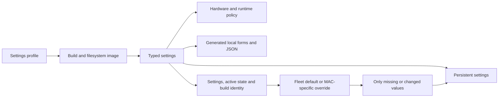

# From ESP32 firmware to an operational device platform

SpaceAI began as a conventional ESP32 firmware project. Sensors, communications, power policy and board-specific behavior accumulated inside one application. By the end of the reviewed history, that application had become the device side of an operational platform: one model controlled hardware configuration, local administration, persistent state, remote per-device management, traceable builds, OTA delivery and rollback.

The decisive change was not another peripheral or protocol. Constants stopped being facts buried in firmware and became typed settings that could travel through the whole system.

```text
constants in firmware
    -> typed settings groups
    -> persistent local configuration
    -> generated administration UI
    -> remote fleet defaults and per-device overrides
    -> traceable build profiles and firmware identity
    -> OTA delivery, rollback and failed-image suppression
```

That is not firmware with more options.

That is a device platform.

## The architectural turn

The original firmware grew through direct product work: GPS, IMU and analog sensing; Wi-Fi, LoRa, Iridium, Swarm and Modbus; datalogs and packet formats; battery control and deep sleep. During 2023, configuration began absorbing the assumptions scattered through that code: GPIO assignments, UART choices, I2C addresses, power timing, communication policy, sensor enablement and retry behavior.

Those values did not move into an inert configuration file. They became a control plane.

The final settings structures serialize themselves into grouped JSON. The firmware loads them from persistent storage, copies intended configuration into active runtime state, and records initialization outcomes without overwriting the intended values. The local web server exposes generated form, JSON and save routes for the same groups. A selected build profile is copied into the filesystem image, while the build records its source profile, Git branch, Git commit, timestamp and firmware filename.

One model now governs what the board intends to run, what actually initialized, what the local operator can edit, what the backend sees and which artifact is deployed.

One model. No competing truth.

## One settings path from the board to the fleet

Local and remote administration are not separate inventories of features. They are two paths through the same settings mechanism.



The device serves `/form/<group>`, `/json/<group>` and `/save/<group>` from its typed settings groups. A local edit is loaded back into the same settings object and persisted. At the configured interval, the device serializes normal settings, sleep settings, active settings and active runtime state and sends them under its MAC-address namespace.

The backend first looks for a device-specific desired document and falls back to the fleet-wide document. It compares those desired values with the device report and returns only values that are absent or different. Fleet defaults and one-device exceptions therefore share one mechanism. The same report carries the settings profile, source revision, build time, firmware filename and active initialization state needed to diagnose what a particular unit was intended to run and what it actually ran.

The local interface required no separate frontend state model. A small JavaScript client renders controls from the JSON emitted by the firmware and posts edits to the generated save routes.

React could render that form. React was not needed. The device already owned the types, values, update path and persistence.

## OTA became recoverable deployment

Downloading a binary is not the interesting part of this update system. Remembering a bad one is.

Build output receives a UTC-sortable firmware filename and is published to either a fleet-wide or MAC-specific update location. The device reports its current build identity. The backend selects a newer applicable image, the firmware installs it into the next OTA partition and reboots.

If the new image fails with a panic or watchdog reset, initialization records that image's filename in `rollback_from`, saves the state, activates the previous partition and restarts. The next active-state report carries the failed filename back to the service. The service removes that filename from the candidate list before choosing an update, so the device does not immediately reinstall the image it just rejected.

```text
publish image
    -> device installs and reboots
        -> success: continue on the new build
        -> failure: remember filename, restore previous partition, report failure
            -> backend suppresses that filename for the device
```

OTA delivers a file.

This system learns which file failed.

A failed release can recover without a technician reflashing the unit, and the delivery service learns enough from the device to avoid repeating the failure. That closed loop is what separates a firmware project with OTA support from a deployment platform.

## The reusable foundation was extracted from the product

The platform did not grow as one permanent firmware directory. Repeated responsibilities moved to the layer that owned them:

- `saipp` took portable C++ filesystem, timing, string, SPI, platform and diagnostic support above `llc`.
- `saithon` took shared Python path, timestamp, Git/build and HTTP operations used by the build and backend.
- `saimon` became the compact settings-history, time-correction and firmware-delivery service.
- `nio_packet_endpoint` became a second-language decoder for the compact telemetry format.

This extraction followed use. The firmware needed the operation first. Reuse earned the boundary. Nothing was generalized in advance merely to look reusable.

The result was not only a more modular embedded application, but C++ and Python support that could serve desktop tests, build tooling and backend processes without importing the whole device program.

## Measured scope

The repository evidence reviewed for this case study ends in November 2024. The two main history logs contain **693 commit records** from 4 November 2022 through 12 November 2024: 374 in the original firmware history and 319 in the successor workspace. The supporting histories add 74 commits in `saipp`, 18 in `saithon` and 38 in `saimon`.

The source inventory prepared from the reviewed final snapshot counted approximately **8,986 physical lines across 81 first-party C++ and Python source files**:

| Component | Files | Physical lines | Operational role |
| --- | ---: | ---: | --- |
| `nio_firmware/src` | 62 | 7,758 | Device firmware and local administration |
| `saipp` | 11 | 789 | Portable C++ platform support |
| `saithon` | 5 | 99 | Shared Python build and backend support |
| `saimon` | 1 | 185 | Remote settings, history and firmware delivery |
| `nio_packet_endpoint` | 2 | 155 | Telemetry ingress and binary packet decoding |

The line count excludes bundled third-party sources, Python environments, generated data, settings profiles, UI assets, upload binaries and build scripts. It describes the reviewed snapshot under that inclusion policy; it is not a timeless count of every file later placed in those repositories. Commit counts and lines establish scope, not quality. The architecture is demonstrated by the continuous control and recovery paths above.

## The economic result

The system changes the unit of variation and the cost of field recovery:

- Board and product variants are represented by settings profiles instead of source branches.
- Local administration and remote management operate on the same typed model.
- Fleet defaults and per-device exceptions share one comparison and update path.
- Remote diagnosis includes intended settings, active state, build identity and source profile.
- Timestamped artifacts remain traceable to their source revision and configuration.
- Failed firmware can roll back without technician reflashing, and the rejected image is not immediately offered again.
- Repeated C++ and Python machinery was extracted for reuse instead of copied into the next tool.

693 commits. 8,986 lines. Useful scale. Not the point.

The point is that one typed control plane absorbed product variation, local operation, fleet management and recoverable deployment without splitting them into competing sources of truth.

## Continue through the evidence

The product story stands on its own. The supporting documents provide deeper source and history detail:

- [System evolution](./system-evolution.md) — the chronological path from the original firmware to fleet operation.
- [Settings and remote management](./settings-and-remote-management.md) — the shared control plane in detail.
- [Final system inventory](./final-system-inventory.md) — the complete reviewed capability and component inventory.
- [Packet endpoint](./packet-endpoint.md) — the receiving side of the compact telemetry protocol.
- [Development lineage](./lineage-from-gpftw-to-firmware.md) — the longer architectural ancestry, kept separate from the product narrative.
- [Application-owned architecture versus frameworks](./architecture-versus-frameworks.md) — the broader architecture argument, where SpaceAI is evidence rather than the subject.
